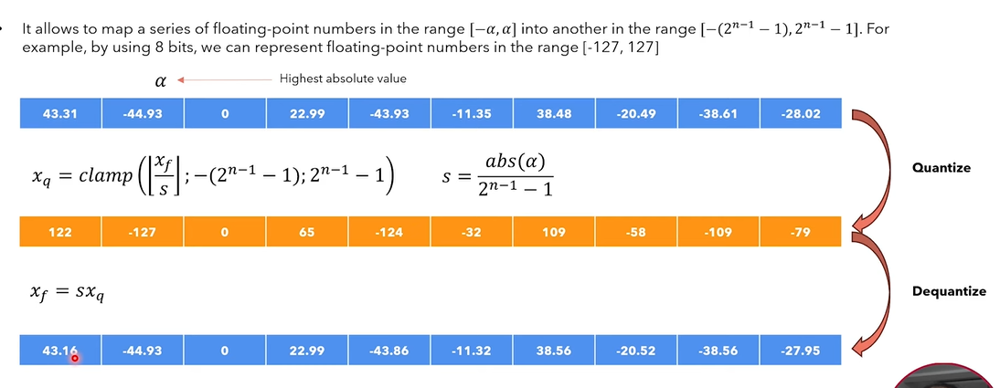
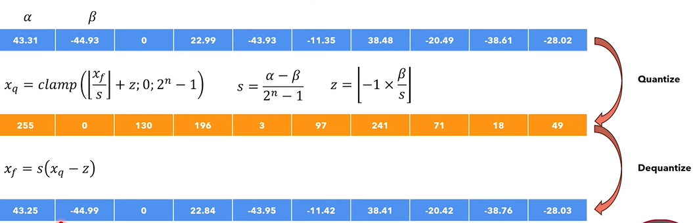
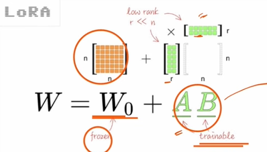

# Fine-Tuning LLMs - Notes & Concepts

> Detailed notes on LLM fine-tuning — LoRA, QLoRA, PEFT, dataset preparation, training configurations, evaluation metrics, and deployment of fine-tuned models.

---

  - Signed and Unsigned:
    - Signed can store both positive and negative values
    - Unsigned can just store positive values
  - Precision:
    - How a numbers are stored in memory.
    - Full Precision: FP32
      - 1 bit = Sign
      - 7 bit = Exponent
      - 22=Mantissa
      - Ex:
        - Number = 7.32
        - 1 bit= +
        - 7 bit stores till 7
        - 22 bit store .32
      - Accurate but slow
    - Half precision FP16
    - Quantized integer : INT8
  - Problem with LLM:
    - Let's suppose if I want to use an LLM in my system which has millions/billions of parameter.
    - Now, in order to do that I needs very high memory and GPU so that my model would be better at inference.
    - If I don’t have high memory and GPU in my system, it won't work as expected.
    - And that's where the quantization comes into the picture.
    - Quantization converts high memory format into a low memory format.
    - Inference is faster  because the integer operation are much faster than floating point operation.
  - Quantization:
    - It is a process of converting high memory format (Like FP 32 )into a low memory format like (INT8) to reduce the memory usage and improve computation efficiency.
    - It basically compression of LLM which has millions and billions of parameter
    - We can also say it reduce the parameter of the model
    - We can also fine tune it after that.
    - Why can't we train our model directly on low precision like (int 8) so that we never need quantization?
      - During training,
        - Forward pass happens
        - Loss is calculated
        - Gradients are computed.
        - Weights are updated tiny amount by tiny amount
        - Those gradients updates can be extremely small.
      - If we use low precision like INT 8:
        - Small changes get rounded
        - Gradients becomes unstable
      - Ex:
        - Suppose a weight is : 0.123423444
        - Gradient update: -0.00083662
        - New weight: 0.1234444
        - FP (32) can store it properly
        - But INT 8 may round agressively, losing tiny updates
    - Problem with Quantization:
      - Quantization reduces model size and speeds up inference by converting high-precision values such as FP32 into lower-precision formats like INT8. Because the conversion involves rounding, some numerical information is lost. For example, a weight value of 1.2345 may become 1.23 after quantization. Since neural networks perform calculations such as y = Wx + b across billions of parameters, these small rounding errors can accumulate and slightly affect model predictions. To minimize accuracy loss, techniques such as Post-Training Quantization, Quantization-Aware Training, and Mixed Precision are commonly used.In order to solve, we have different techniques.
    - Types of Quantization:
      - Post Training Quantization:
        - In these, we perform the quantization after the pre-training.
        - Model is trained on a high precession (FP 32)
        - After training, weights are quantized (INT 8)
        - During inference, model uses quantized weights.
        - Problem:
          - Accuracy may loose
          - Precession is reduced
          - Small value may get lost
      - Quantization aware training:
        - Here, we try to simulate the quantization during training so that model learn to handle the precession loss during the quantization
        - Training:
          - FP32 -> Fake Quantization -> Forward Pass -> Backpropagation
          - The weights are still stored and Updated in High precession but the model learn to tolerate quantization error.
        - After Training, model is converted into truly quantized version
        - Inference, runs with IN8/IN4 weights
        - Dequantization may occur during inference when low-precision values need to be converted back to floating-point values for certain computations or outputs, although modern hardware tries to keep most operations in low precision to maximize performance.
        - All the techniques like LORA, QLORA comes under the quantization aware training
        - Intuition:
          - Train model already experiencing quantization noise
    - How to perform quantization:
      - Symmetric Quantization:
        - In symmetric quantization, the quantized values are centered around zero and the integer range has equal magnitude at both the positive and negative side.
        - Range: [-127, 127]
        - To convert into FP 32 into INT8, we have a formula = round(floating point number / scale)
        - To calculate scale, formula (Xmax - Xmin)/ Qmax - Qmin

        

      - Asymmetric Quantization:
        - It maps floating point values into an integer range that is not centered around zero.
        - Range: [0,255]
        - Zero point: To preserve exact zero representation.
          - after quantization. Might be possible that we get the quantized value in negative but as our range in positive, we add the same number so that the value become zero and that is called a zero point number.

        

  - Fine Tuning
    - It is a process of training a pre-trained model on a specific dataset so that the model won't get hallucinate at the time of inference and will get a proper o/p
    - Types of fine tuning:
      - Full Parameter training:
        - In this type of fine tuning, we adjust all the parameter of the model for a specific dataset on which we want out model to be tranind
        - Ex: if a model has 70B parameter, that means 70B parameter would get adjust for the traning
        - Problem:
          - Would require good hardware like RAM and GPU
          - To solve this problem LORA comes into the picture
      - LORA (Low Rank Adaption)

        

        - It is a parameter efficient fine tuning technique used for large language models. Instead of training all the millions of parameter,freezes the original pretrained weights and using matrix decompositions, divide it into two smaller trainable matrix based on Rank that learn task-specific adjustments. This greatly reduces GPU memory and training cost while still achieving good performance.
        - W0 + ^W= W0 + BA
          - Size of B = Dimension * Rank
          - Size of A = Rank * Dimension
        - During Fine Tuning Training:
          - Y= W + BA
          - Only, A and B are updated during Back Propagation
          - After Training, we have two choices
            - Merge LORA
              - Wnew = W + BA
              - Wnew= W
              - Then, it gives a final matrix.
            - Use LORA separate
              - Instead of adding BA to W, use it separate
              - Q= W +BA
        - At inference:
          - If the LORA is merged from Model::
            - Let's suppose, calculating q, k and v
            - Q= X * Wq, K = X *Wk, V = X * Wv
          - If the LORA is separate from Model:
            - Let's suppose, calculating q, k and v
            - Q= X * (Wq + Bq*Aq) ,
        - Why it is efficient?
          - It only stores the gradient only for the small matrices.
        - Why two matrices?
          - To create low rank approximations
        - What is Rank?
          - How many independent row and columns are there
          - As the rank increases, no of trainable matrix also increases
          - Small intermediate dimension used to compress the weight updates
          - How much info LORA can lean
            - Small rank:
              - More compression
              - Few trainable parameter
              - Low memory usage
              - But may not lean complex patterns
            - High rank
              - Opposite of small rank
        - It use w-> Wx+ Bax, that's it doesn't changes all the model weights
        - Problem:
          - Even through, you have LORA train small matrices like A and B
          - Still the huge model needs to be stored into the memory
      - QLORA:
        - It compresses the frozen model to.
  - Flow of Fine tuning
    - Choose base model
    - Prepare dataset
    - Format dataset
      - Same prompt template as base model
    - Tokenization
    - Load model
    - Apply LORA/ QLORA
    - Train
    - Evaluate
    - Save adapters and deploy
