# Hands-On LLM - Practical Notes & Implementation

> Practical hands-on notes covering LLM implementations, fine-tuning workflows, agent frameworks, prompt engineering, and real-world LLM application patterns.

---

- **Transformer architecture:**

  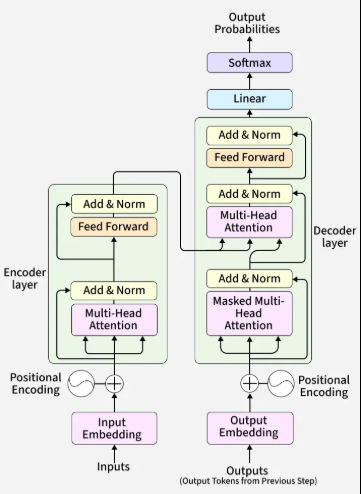

- **History of LLM: (Chapter 1)**

- **Language AI is a field of AI where we try to understand, process and generate Human language.**

- **History of AI:**
  - Text is unstructured in nature and loses its meaning when represented by 0 and 1
  - That's why a large focus has been on representing language in a structured manner so that it would be easily understand by computers
  - History starts with a technique called bag of words:
    - Bag of words is an algo to convert text into numbers so that computer can understand it.
    - Does it work for training or for inference?
      - Let's suppose we have a huge text. We first divide that huge text into words using the whitespace.
      - After diving, we would only keep the unique words that means if a words is getting repeated we only consider it once.
      - It creates a bag of words which we also call vocab
      - Let's suppose if a sentence is given as an input, how we generate vector repesentation
      - First, the vector size will be equal to the vocab size where each dimension represent a word in the vocab
      - Second, each words present in the vocab, we count how many time same word appear in the input sentence and that count we store in the vector representation.
      - We perform same logic with all the words present in the vocab
    - Also,**vector size = vocabulary size** for every sentence.

      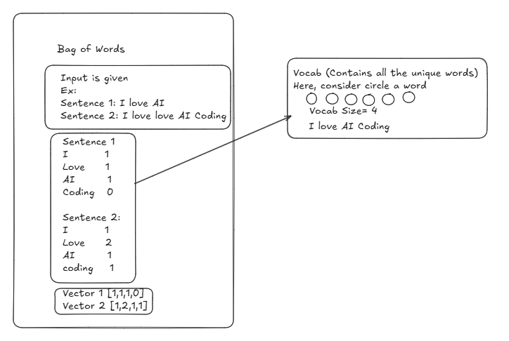

  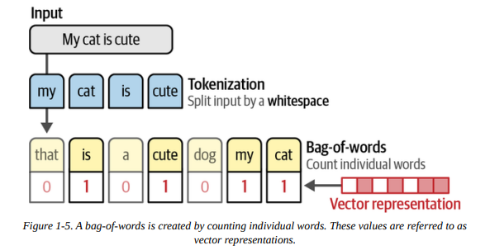

- **There was below issues with the Bag of words:**
  - No semantic meaning
  - Huge vectors (depend of vocab size)

- **But a bag of words ignores the semantic nature or meaning of text**
  - Released in 2013, word2vec .
  - This was the first time when we tried to store the semantic meaning of a word using embeddings
  - Words appears in similar context have similar vectors
  - We start assigning each word in the vocab and 50 values for each word inititilized wit  nh random values.
  - Then in training step model attempts to predict the next word
  - Embedding are tremendously helpful as they allow us to measure the semantic similarity between the words. Using different distance metrices , we can judge how close one word is from another.
  - Types of embedding:

    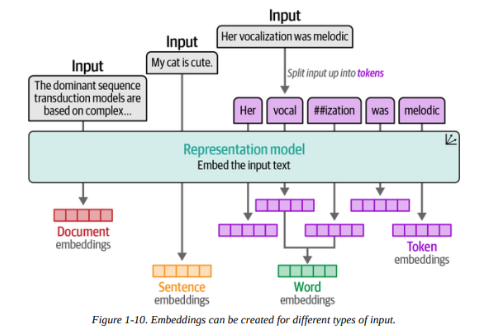

- **The training process of word2vec creates static representation of words.**

- **For instance the word "bank" will always have same embedding regardless of the context in which it is used.**

- **However, bank can both financial or bank of river depends on the context**

- **Recurrent Neural Network (RNN):**
  - To solve the problem of word2vec, it uses the autoregressive nature.
    - Autoregressive : In order to generate the next word, it uses all the previously generated embeddings
  - RNN used to perform two tasks:
    - Encoding or Representing an input sentence
    - Decoding or generating an output sentence

  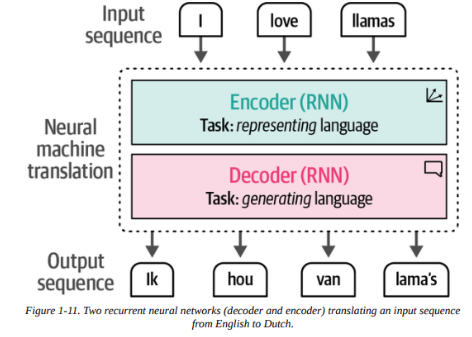

  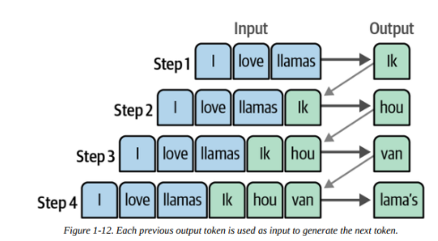

- **But the is a process with the autoregressive or context embedding in RNN. It makes difficult when we have larger sentences.**

- **In 2014, a solution called attention is introduced**

- **Attention allow model to focus only those part of the input which are relevant to one another.**

- **By adding the attention mechanism in the decoder step , the RNN can generate signals for each input words in the sequence related to the potential o/p.**

  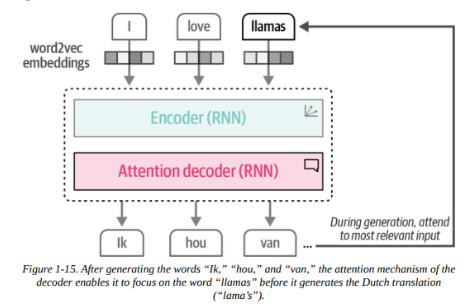

- **Attention is all you need:**
  - A Neural Network architecture was introduced in this paper called Transformers.
  - This architecture was based on the Attention mechanism and remove the recurrence network that we saw earlier
  - Compared to recurrence network, transformers could be trained in parallel.
  - The architecture remains autoregressive

  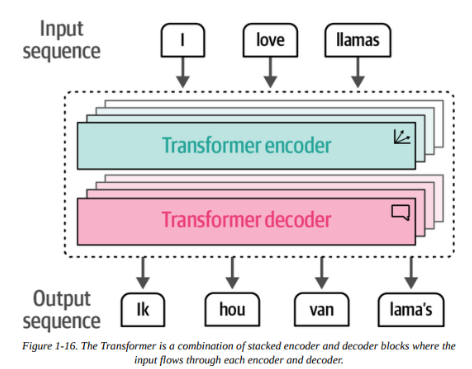

  - Both encoder and decoder revolved around attention
  - Encoder block:
    - Self-attention: It allows the model to focus on those part which are relevant within the same sentence which helps the model to understand context in a better way

    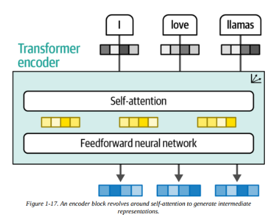

- **Decoder block:**
  - Self-attention in the decoder block masks future positions so that I only attends earlier positions

  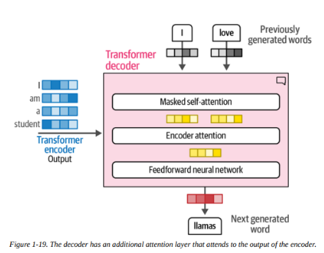

  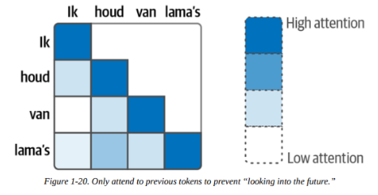

- **Representation Model: Encoder only model:**
  - The original transformer is an encoder-decoder architecture that serves translation tasks well but can't be easily use for other tasks.
  - In 2018, a new architecture called Bidirectional Encoder representations from Transformers (BERT) was introduced.
  - It is an encoder only architecture that focuses on representing language

- **Tokens and Embeddings: (Chater 2)**
  - Token is basically a small chunk of the data
  - Embedding is a numerical representation of a word or a sentence.
  - Tokenization is a process of breaking a big sentence into smaller chunks called tokens
  - Tokenizer does that for us and assign a unique number to that.
  - Before the prompt is presented to the language model , however It first has to go through a tokenizer that breaks  it into smaller pieces
  - The input is passed to the tokenizer which return some id's
  - These id's reference a table inside the tokenizer containing all the tokens it knows
  - Where does the token id's comes from?
    - At the training step of the Tokenizer, it creates  a big table inside which contains tokens and the token id's.
    - When we give a sentence as an input, the tokenizer uses the same table to provide the token id for the new input prompt

    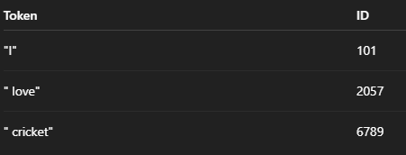

  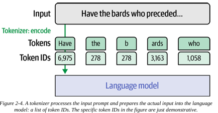

- **How does the tokenizer break down the text (tokenizer designing)?**
  - First at model designing, chooses a tokenization method. Popular methods include BPE, Word piece
  - Second, tokenizer design choices like vocab size, special tokens
  - Third, Tokenizer trained on a specific dataset to establish best vocab.

- **Tokenizer method at training = tokenizer method at inference**

  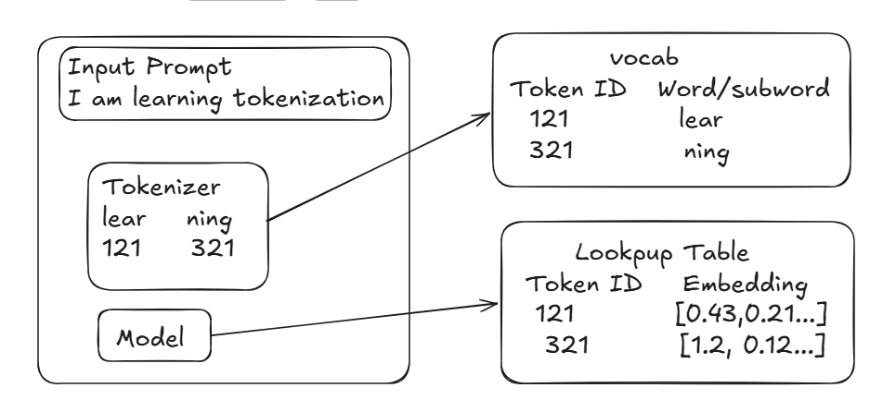

- **Flow:**
  - Input is given.
  - Using the tokenizer, it first divided the sentence and provide the token id
  - There is a lookup table which contains the embedding for those token id

- **Tokenization Method:**
  - Byte Pair Encoding:
    - It is a sub-word tokenization method to break text into smaller chunks
    - It iteratively merges most common adjacent pair of characters or sub words into a new single token until a predefined vocab size is reached.
    - Why do we need?
      - Character or words level
        - To many words too many tokens
      - BPE:
        - Common words= single tokens

- **Embedding:**
  - Numerical representation of text or images
  - After tokenizer initiated and trained, it is then used in the training process of its associated language model
  - The language model hold an embedding vector for each token in the tokenizers lib.
  - When we download a pretrained model , a portion of the model is this embedding matrix
  - Before the beginning of the training process, the vectors are initialized randomly

  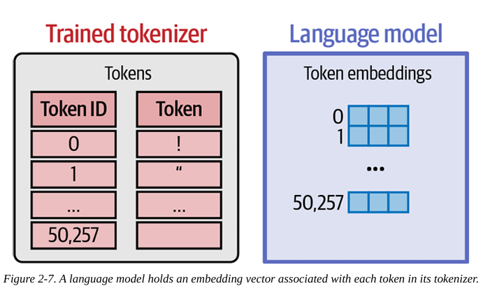

  - Flow: Sentence-> token-> static embedding-> transformer->contextual embedding

  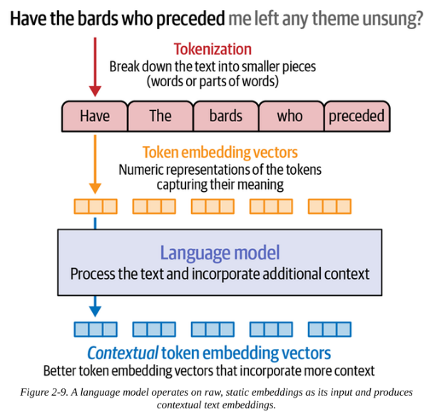

- **Looking inside LLM (Chapter 3)**
  - There are two main components: Tokenizer and LM Head
  - The tokenizer is followed by the NN: a stack of transformer that performs all the processing. Then stack is followed by LM Head which translates the o/p of the stack into probability scores for what the most likely next token is.

  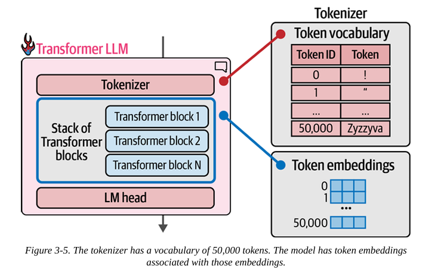

- **Each of the generated token goes from start to end.**
  - Tokenizer generate the token id
  - LLM looks for the embedding stored with the model
  - Transformer block does all the processing.
  - LM head tells all the vocab words probability to appear next.
  - The same process is repeated for all the generated tokens

  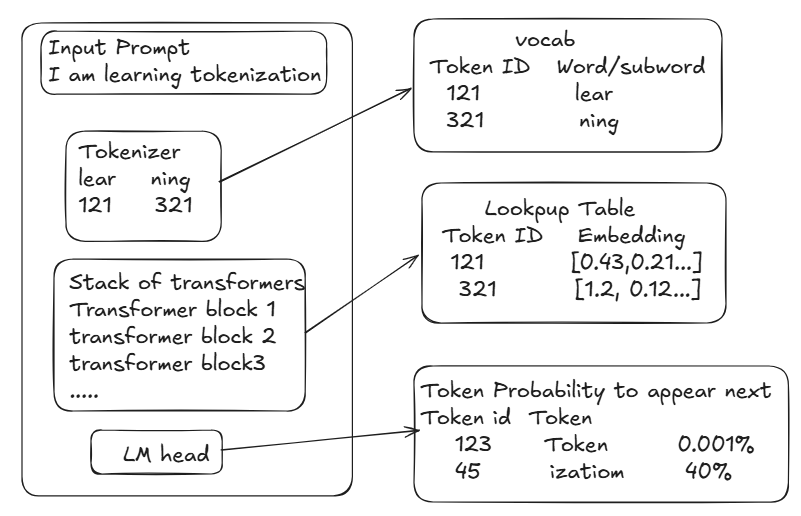

- **Decoding strategy:**
  - The method of choosing the single token from the probability distribution is called decoding strategy
  - The easiest way to pick the token with the highest probability know as greedy decoding but this doesn't tend to lead to the best o/p for most cases
  - The best is to choose second or third highest probability token.
  - Why not to choose the highest probability?
    - Very repetitive
    - Sometime boring or unnatural
    - Ex: "The weather is"
    - Greedy: "The weather is good. The weather is good. The weather is good."
    - It happened because model is trained to pick always highest probability

- **Parallel token processing an Context size:**
  - Biggest advantage of transformer is that it does parallel processing for each token
  - They token also connected with the other via attention

  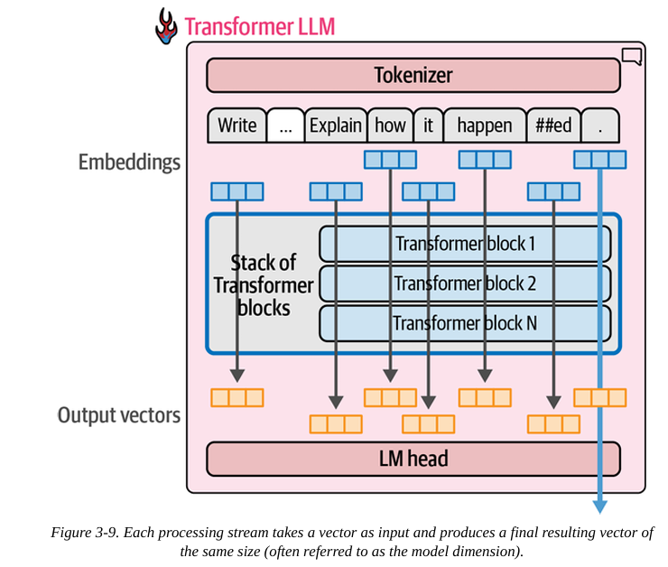

- **Current transformer have a limit for how many tokens they can process at once. This limit is called the model's context length.**

- **Only the last processed token is passed to the LM head in order to generate the next token.**

- **Why we process all other tokens if the last token is given to LM head?**
  - The calculation of other streams are required and are used in order to calculate the last stream

- **Speeding up generation by caching keys and values:**
  - When generating the second token, we append the token to the input and do another forward pass to the model
  - If we give the model capability to cache the results of the previous calculations, we no longer need to repeat the calculation of previous streams again.
  - Only the last stream calculation needs to be done.
  - This is called keys and values (kv) cache

  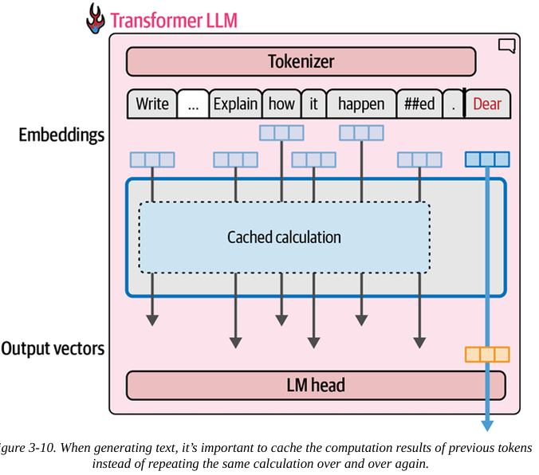

- **Inside the transformer block:**
  - It consists of two parts:
    - Attention: it is used to get the relevant info from other input tokens and positions
    - Feed forward network: it houses the majority of the processing capacity

    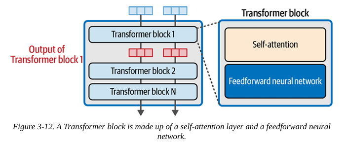

  - Feedforward network:
    - In all the collective model layers, it is the source of information.
    - When a model is trained on a huge amount of data then, it learned and stored info that makes it succeed at this task.

    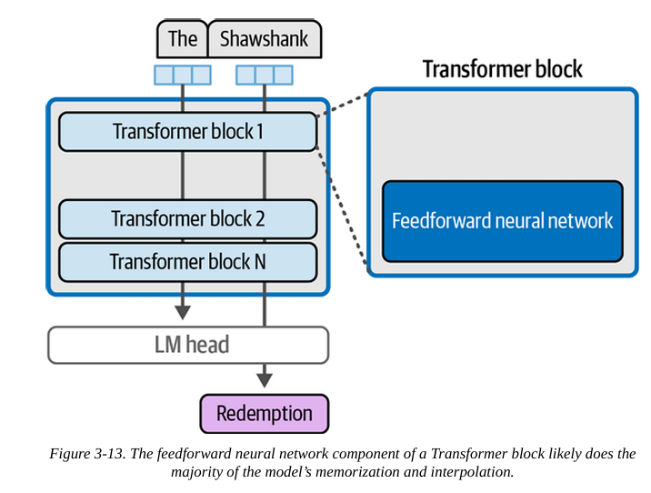

  - Attention is all you need:

    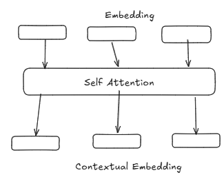

    - Self-Attention takes the static vector and converts it into contextual vector.
    - It captures the relationship between tokens
    - Contextual vector hare the representation of a token based on its surrounding which helps to achieve a good accuracyx
    - There are 2 main steps involved in the attention mechanism
      - A way to score how relevant each of the previous input tokens are to the current token being processed
      - Using those score, we combine the information from various positions into a single o/p vector.

      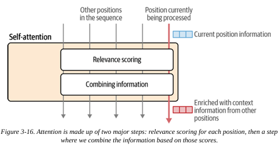

    - To give transformer more extensive attention capability, the attention mechanism is duplicated and executed multiple times in parallel called multi- head attention
    - Each of these parallel applications of attentions is conducted into an attention head.
    - In order to convert the embedding into the contextual embedding, we need to calculate:
      - Query
        - It represent the token for which we want to calculate the attention.
        - Query . Key = attention score (how much attention to give to each token relative to current token)
        - Contextual understanding: it help us to calculate the relationship between the current token and the rest of the sequence.
      - Key:
        - Keys are vector representations of every token that queries are compared against to compute attention scores.
        - It helps to find the most relevant info from a token sequence in order to calculate the attention score of a token.
      - Value vector:
        - It contains the actual info which will aggregated to form the O/P of the attention mechanism
    - In Self- attention , there are two types of weights:
      - Learned matrices weight (static):
        - Learned during training
        - Fixed during inference
        - Sam for all the tokens.
        - Wq , Wk, Wv
          - Values inside the matrix  are not same
          - Matrix size is identical.

- **Attention Weights (dynamic):**
  - Softmax(Q * K(transpose))

- **Once the attention score is calculated, we perform scaling**

- **Scaling:**
  - In scaling, we take the attention score and divide it with dk where dk is the dimensions
  - It help use to prevent attention scores growing to large.
  - What happens if the scores become too large?
    - Gradient exploding
    - Softmax saturation:
      - Most of the attention weight is assigned to a single token
      - Other becomes very small

- **Masking:**
  - In autoregressive model, a token can't see future token.
  - We present it by infinity
  - If we are masking future token attention score, then why do we even calculate?
    - Even though some attention scores are masked, they are still computed because attention is implemented as a full matrix multiplication for efficiency, and masking is applied afterward to enforce causality.

- **Calculating softmax:**
  - It is used to convert the attention score into the probabilities that sum to 1.

- **After that we multiply, the matrix to v.**
  - Why?
    - Attention score only tells you how important each word is , while multiplying those score with the values vectors actually combines the information to produce a meaningful, context aware representation

- **O/p Projection:**
  - After we get a contextual embedding from self-attention, it then passed to the projection output.
  - The o/p that we got from self- attention is not directly used with the other layers because it was still raw.
    - Raw means:
      - Some dimension might overlap in meaning.
      - Redundant
  - It was optimized then used by the next layer.
  - ProjOut=  Self attention o/p * W0
    - W0
      - It is a learned weighted matrix
      - Used to transform the self-attention O/P into  a better representation.
      - It is also used to compress the multi head attention O/P into a final vector.
      - It doesn’t add new info, it just rearranges the weights

- **Add residual Connection:**
  - Residual mean "don't forget the original information - add it back".
  - Why we need?
    - It might happens that during the o/p project, we might miss some of the actual info while balancing the weights
    - Vanishing gradient:
      - Gradient: it's a number which tells how to change a weight to reduce error.
      - It's a problem when gradient becomes too small

- **Layer Normalization:**
  - Mean: it tells you where is the center
  - Standard deviation: how far the number is from center.
  - Normalization is a process of adjusting numbers so that they are centered around 0 and scale to a consistent range making it easier for model to learn pattern.
  - Problem without normalization:
    - vector 1=[1,2,3]  vector=[10,20,30]
    - Same pattern but different scale
    - Model might treat vector 2 as more important because it has high values
    - Solution: Divide by std
    - Both become [-1,0,1], same scale , same importance
    - Std=1 remove scales differences
  - It might be possible that we have two vectors and one vector has very high values and second vector has low values.
  - This creates a problem while training that model could provide mode preference to the first vector because the values are high.
  - In normalization, we try to scale the vectors so that our training performs smoothly.

- **Feedforward neural network:**
  - A small neural network applied individually to each word at a time vector.
  - Processes each word at a time
  - Need of FNN?
    - Attention mixes information between words
    - FFN processes info inside each word
    - The feed-forward network is required because attention only mixes information between words, while the FFN applies non-linear transformations to each word’s representation, allowing the model to learn complex patterns and refine the contextual information.
  - Features:
    - Add non linearity
    - Process each word at a time

- **Masking:**
  - Masking is a mechanism in decoder that helps to look at only the previous tokens, not the future ones
  - Problem:
    - While training, without masking let's suppose we have a sentence "I love AI"
    - While predicting the token "ai", the model can see "ai"
    - Predictions becomes trivial (cheating)
  - Solution:
    - Don’t allow the model to see the future words
    - Ex: I love__

  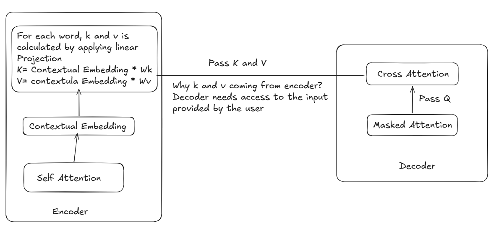

- **Linear Projection:**
  - LM head is responsible  to convert the vector representation into the probability score for each word in the vocab
  - After softmax using the probability distribution, final words is selected.
