# LangChain - Notes & Concepts

> Comprehensive notes on LangChain — chains, agents, memory, tools, LCEL (LangChain Expression Language), Runnable Lambdas, document loaders, and practical LLM application patterns.

---

- **Langchain is a framework which is used to build LLM based application.**

- **Problem before langchain:**
  - Every model provides has their own SDK and different code. So to use them we need to make a lot of configuration files which is very time taking.

- **Components:**
  - Models:
    - Models helps use to connect with different different LLM providers.
    - It provides build in classes for all the main LLM provider which makes very easy to connect with LLM
    - Also, switch between LLM becomes easier
    - Types of model:
      - Chat models:
        - Generate text
        - Write code
        - Question answer
      - Embedding model
        - Convert text into vectors
        - Used in RAG's
      - Multi models:
        - Work with more than text
        - Video and images
  - Prompts:
    - A prompt is basically an input that we give to the LLM
    - Tells the model:
      - What to do
      - How to respond
      - Many more
    - The quality of o/p depends on your prompt hence it becomes very important.
    - Types of Prompt:
      - Simple prompt:
        - Just a direction instruction.
      - System + user prompt:
        - System: behavior sets
        - User : Asks question
      - Prompt Templates:
        - Instead of writing prompt again and again, use prompt templates
        - It is used to made reusable prompts
  - Chains:
    - It is a sequence of text connected together.
    - Instead of :
      - One prompt -> one response
      - We create, step 1-> step 2-> step 3-> Final Output
    - Ex: "summarize the article and translate it into Hindi"
      - Summarize text
      - Translate summary
      - Return result
      - That's a chain
  - Memory:
    - Memory allows the AI system to remember the past interactions
    - Without memory:
      - Every message is independent
    - With memory:
      - The model can use previous context
  - Indexes:
    - It allows us to connect to an external data to an LLM
  - Agents:
    - Ai system that helps to decide what steps needs to be taken next.
    - It is used to perform certain action.

- **LCEL (Langchain Expression language)**
  - It is a declarative way to create chains in langchain by composing component with pipe operator
  - Before LCEL,
    - every component has their own method to use that component.
    - That becomes hard to manage and even understand.
      - Ex: parser -> parse ()
      - Prompt -> format()
  - After LCEL,
    - A common interface is introduced called runnable.
    - Every component uses it.
    - Benefit
      - Common method for all the component
      - Parser -> invoke()
      - LLM -> invoke()
  - Runnable is common abstraction which can take input, process it and give an o/p

- **Streaming:**
  - It helps model to stream the response once it is generated instead of waiting for generating the complete response.

  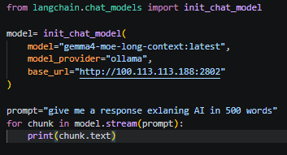

  - It would stream the o/p once it is generated

- **Difference between model. Invoke VS agent.invoke?**
  - While calling "model.invoke", it doesn't maintain a state that means when you give a prompt it just returns the AI message. Next time, when you again ask any question, it would not remember the previous conversation.
  - While calling agent, it will return a JSON o/p containing a complete flow of execution.

- **Practical:**
  - To use Chat model:
    - Use Init_chat_model:
      - Init_chat_model(model="llama3.2:latest", model_provider="ollama", base_url="http://100.113.113.188:2802")
    - Use Model provider classes:
      - ChatOllama(model="llama3.2:latest", base_url="http://100.113.113.188:2802")
    - Then use invoke method to run the model.
  - To use embedding model:
    - embedding= OllamaEmbeddings(model="qwen3-embedding:0.6b",base_url="http://100.113.113.188:2802",dimensions=28)
    - To call the embedding model:
      - For single sentence:
        - Use : embedding.embed_query("what is the capital of India")
      - For a document:
        - Use : embedding.embed_document(text)
  - O/p when we create an agent using create_agent

    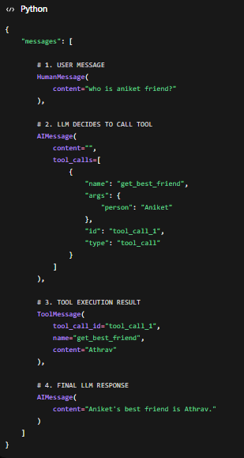

  - Creating a chatbot:

    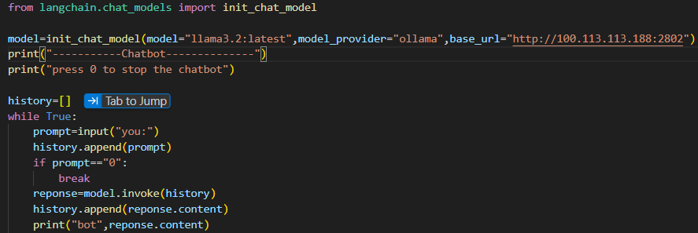

    - In the above code, I am storing the history in a list variable called "history"
    - Question: if I can make the history of the chat via a variable then what problem can we face
      - No role separation (no system /user/assistant)
        - Solution
          - First Fix: Assigning role
            - In "langchain_core.messages"

            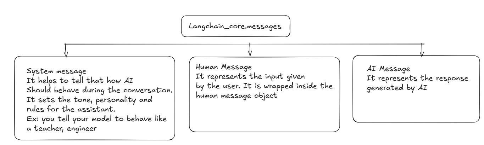

- **Memory keeps growing**

- **API cost increases overtime**

- **Context length:**
  - Model has context length, if history grows then LLM might get hallucinate

- **No structure**
  - LLM might misunderstood role

- **No memory management:**
  - What to keep
  - What to store

- **No summarization:**
  - Old conversation are :
    - Repeated again and again
    - Waste tokens
  - Data tokens and the valie

- **Structured O/P**
  - Forcing LLM to return data in a fixed format.
  - Why normal O/P is a problem?
    - LLM generates free form text
      - Prompt: Extract name and age
      - O/P: John is 25 years old, Name: John, Age: 25
    - Inconsistent format
    - Hard to use in code.
  - Why we need structured O/P?
    - In order to make the O/P machine readable so that we can use further.
    - For example: if we want to create a new record in the database, we need the O/P in the json format

    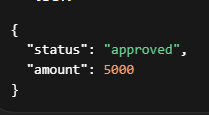

  - Pydantic:
    - It is a tool which helps use to create structured O/P
    - It provides you field validation , descriptions and nested structure
    - Pydantic lib needs to be installed.
    - It creates JSON object

    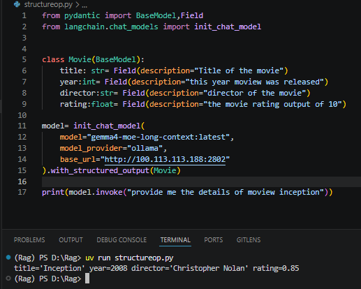

    - Nested Structure:

      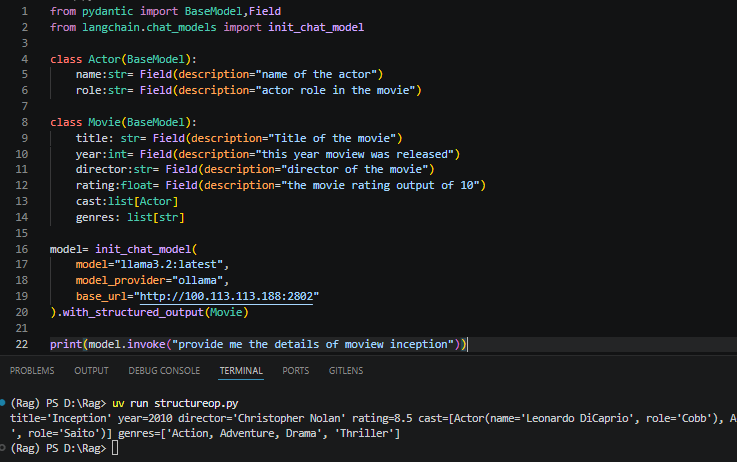

- **Middleware**
  - Middleware is a layer that runs before/after agent or model execution to modify, monitor or control execution flow.
  - It controls the request and response

  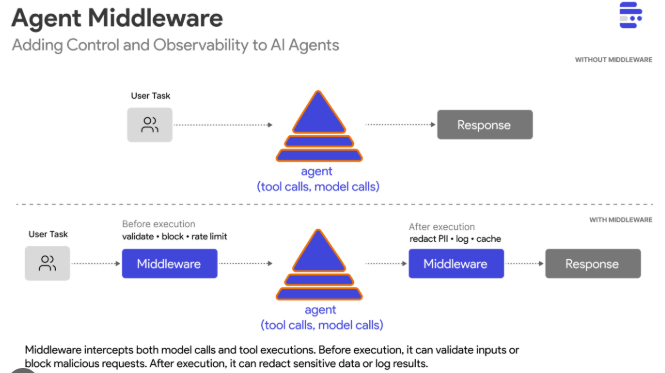

  - Example:
    - Suppose, you went to a restaurant.
    - You gave an order to a waiter.
    - Before chef actually prepare you dish, what could a waiter does:
      - Check the order
      - Modify the order
      - Reject invalid orders
      - Log the bill
      - Send to different chef
    - Here, the waiter layer is middle ware
  - Why middleware imp?
    - Guardrails: Is the request correct
    - Logging
    - Authentication and Authorization
    - Prompt engineering
      - Original: "What is AI?"
      - Modified:  "You are a senior AI teacher. Explain simply. Question: What is AI?"
    - Routing:
      - Send request to different model
    - Memory management: Summarization Middle ware
  - Types of middleware:
    - Built in middleware
      - Summarization middleware:
        - Whenever we reaches the certain limit of the message, we would summarize the chats
        - Used in long running conversation
        - Checkpoint is something which helps agent to become stateful

        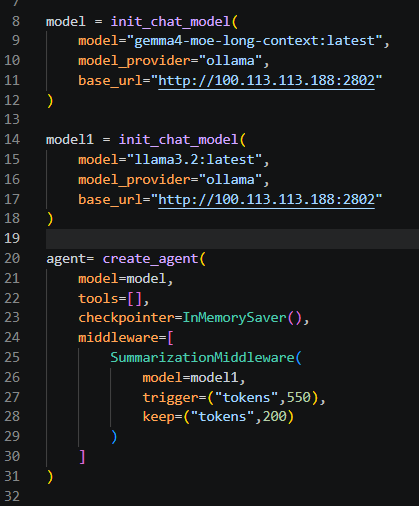

    - Custom middleware.
      - Here, we can based on our requirement
      - We can use different Hooks here.

        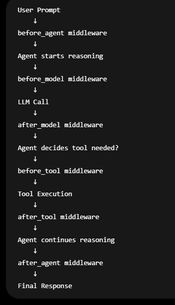

- **Two ways we can define custom middleware:**
  - Using decorator
  - Using AgentMiddleware class

    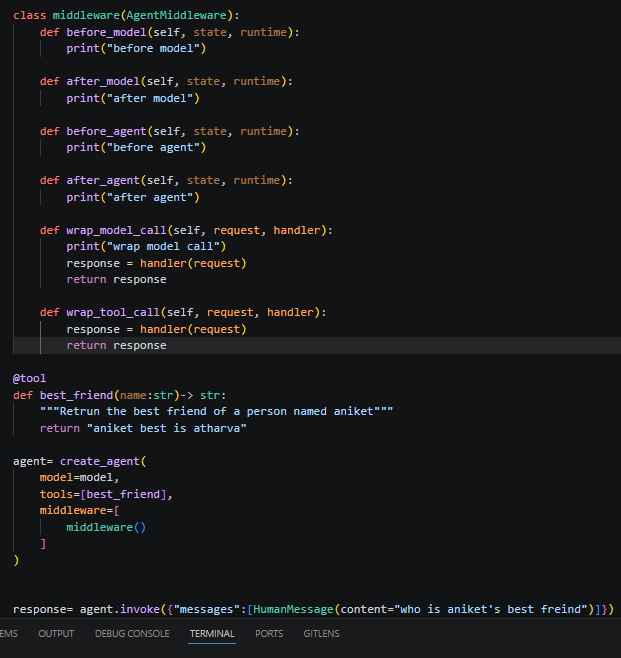

- **It has two things state and runtime:**
  - State:
    - It represent a the current situation of the system.
    - Ex: count=5 that means it a state of a program
    - In langchain, we don’t need to manage it.
    - Agents are stateful in nature they does it automatically

- **Profile:**
  - There is property called profile which helps us to identify what model is capable of.
  - User: model.profile
  - Ollama might return None as it depends on the model provider as well

  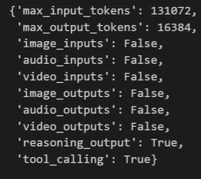
