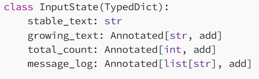
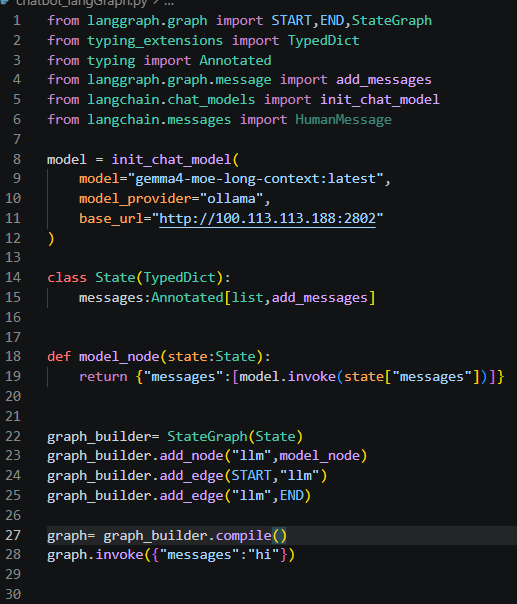
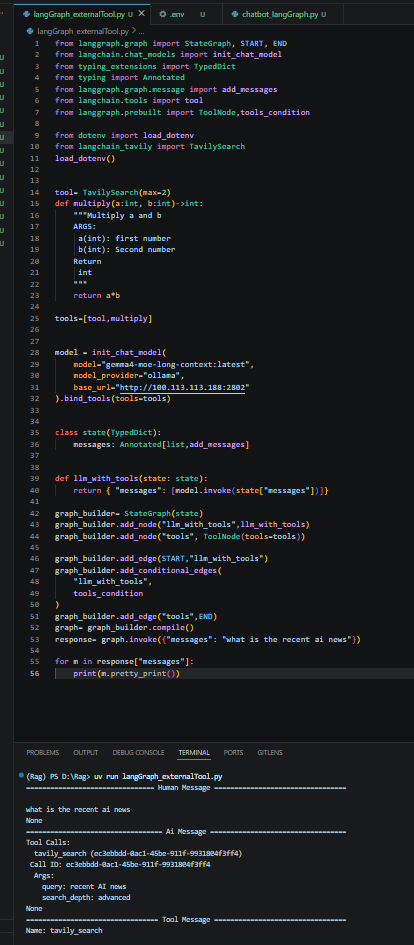
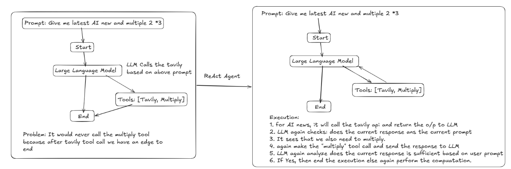
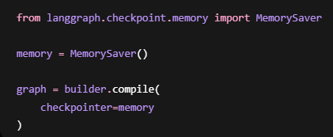
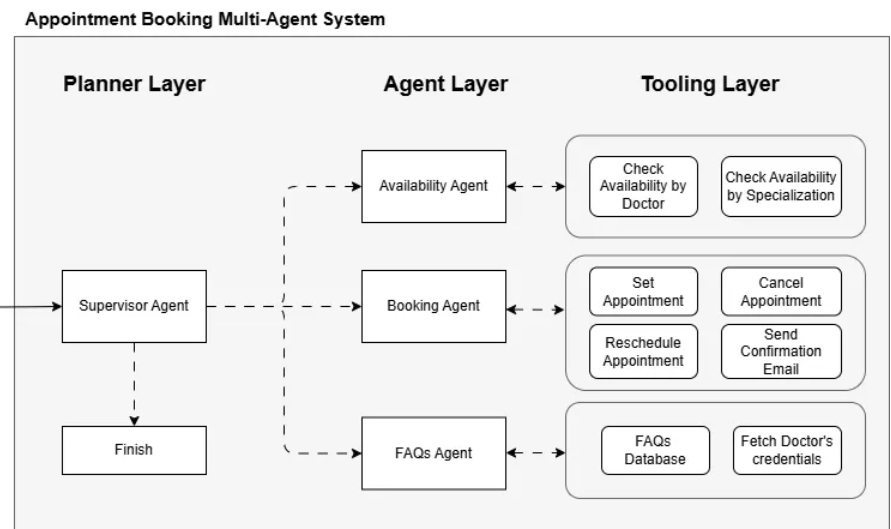

# LangGraph - Notes & Concepts

> In-depth notes on LangGraph — stateful multi-agent graphs, nodes, edges, checkpointers, memory persistence, conditional routing, and building production-grade agentic workflows.

---

  - It is a graph based framework build on top of langchain.
  - It is used to build stateful, complex AI agents and Workflows using nodes and edges
  - Why langGraph?
    - Traditional langchain chains in a linear pipeline
    - In real world problem, we require
      - Loops
      - Memory
      - Retries
      - Tool selection
      - Branching
    - And langGraph provided all of this.
  - It is a multiagent orchestration tool
    - Orchestration means using multiple components in order to complete a task.
    - Here, we use multiple agents co-ordinating with each other in order to complete a task
    - Orchestration will decide:
      - Who will work first
      - Who receive whose o/p
      - Who reviews what
  - Why LangGraph is powerful orchestration tool?
    - It uses graph
    - Each node an agent
    - Edges define orchestration
  - It helps us to build
    - Stateful AI workflow using Check point in memory
    - Multi Agents System
    - Agentic RAG
    - Long Running Workflows
  - Entire framework is based on three Components:
    - State
      - It is a shared memory flowing through the graph.
      - It represents the current data at any point of the workflow
      - It can be defined either using pydantic and Typed dict
        - Using Typed dict primary purpose is to provide a structured and well defined state for the entire graph workflow.
      - Each node can read, modify and return updated states
    - Nodes
      - It represents a function
      - Ex: LLM Calls, Tool execution, Retrieval
      - Start and End Nodes:
        - Special Nodes used to define Start and End
    - Edges
      - Edges define Workflow movement
      - Conditional Edges:
        - We can also define conditional edges
    - State Graph
      - It is a core graph that manages the flow of shared state between the nodes(agents/function)
      - Each node represents the functions and edges present the execution flow between them.
      - Each node performs computation and updates the shared state.
      - The graph follows a defined execution flow ensuring logical processing of the tasks.
      - It is a class in LangGraph which is used to build complex and stateful workflows
      - It is not the runtime of the graph which just used to define the blueprint of the graph like how many nodes, edges and all. We need to compile it in order to process.
    - Reducers:
      - It is used to control how state updates are merged when multiple node update the same state field
      - Ex: state= { message:[] }
      - Agent A add message
      - Agent B add message
      - Without reducer, any update will just overwrite the same variable

      

      - Here, stable_text don’t have any reducer
  - Basic LangGraph Chatbot Code:

    

  - Whenever a node returns in Json, it means it wants to update the state.
  - Graph.invoke always requires the input type as defined in state.
  - LangGraph with tools:
    - Tools : Tavily and Multiply

    

    - We have StateGraph which take the state as a parameter and the same state we need to give as an input.
    - We use bind_tools method in order to bind tools with LLM as I have done in the above code
    - Conditional edge is used when we want our model to restrict that whenever there is a requirement then only call the tools.
      - Here, this tool_condition ensures that if no tool call is required to would internally create an edge to end.
    - Problem:

      

  - CheckPointer:
    - It is used to persist the memory so that the model would remember the past conversation.
    - It says the workflow progress

    

    - Checkpointer requires Thread id
  - Humam in the Loop:
    - When the agent requires human intervention.
  - Message State:
    - In the above code, we were creating a variable inside state class which was managing the state of message within the workflow.
    - LangGraph also provide "MessageState" which internally works the same way as it is working in the above code
      - from langgraph.graph import MessagesState
      - class State(MessagesState):

pass
  - Multi- Agents:
    - Where multiple agents interact, collaborate, or coordinate in order to solve a problem.
    - Why:
      - One single agent can be
        - Overloaded
        - Less accurate
        - Difficult to control
      - So we can create specialized agents
    - Why langGraph is good at multiagent
      - It supports graph structure
      - State sharing
      - Conditional routing
    - Multi- Agent Pattern in LangGraph:
      - Sequential Agent:
        - One agent is connected to another in a sequence
      - Supervisor agent pattern:
        - Here, we have a supervisor which controls all the other agents.
        - It divided workflows into three layer
          - Planner layer: acts as a orchestrator, delegating task among agents and determine where the execution flow should conclude
          - Agents layer: all the agents where each agent is used to perform specific task
          - Tooling layer: provides a shared pool of tools

          

      - He
  - There are two ways to solve a complex problem:
    - Graph API
    - Functional API
