# MCP (Model Context Protocol) - Notes & Concepts

> Comprehensive notes on Model Context Protocol (MCP) — server setup, tool calling, client-server architecture, and integration with LLM frameworks.

---

  - MCP is an open standard introduced by anthropic that bridges AI model with external data and services
  - It is a universal adapter
  - MCP layer enables AI application to securely access and interact with external data sources and tools.
  - MCP uses a client server architecture to achieve this.
  - An AI powered application( e.g. Chatbot, IDE assistant or agent) acts as a host and runs an MCP client component.
  - Each external integration runs as an MCP server. The server exposes capabilities (like functions, data resources or prompt templates) over the MCP protocol
  - MCP services:
    - Tools: Tool is basically a function which is used to perform some specific operation.
    - Resource: A Resource in MCP is a read-only source of information that provides context to the LLM. Unlike tools, resources do not perform actions; they expose data such as documents, files, database records, policies, or knowledge that the model can read and use while generating responses.
      - Example:
        - Let's suppose, you want to fetch the status of a project
        - You might need a tool which helps you to connect with the database and provide you the relevant info.
        - Instead you can leverage the capability of resource.

**Tool = Do something**

**Resource = Read something**

**Prompt = Guide how to respond**

  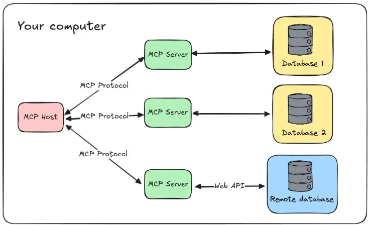

  - Why MCP is valuable:
    - Let's suppose, there is a company:
      - It stores customer information
      - A Jira server containing project tasks
      - A share point folder containing documents
      - Financial Data
    - Now, let's suppose, you ask a question to your LLM related to this information but your ai assistant won't be able to answer because it was not trained on this data.
    - Hence, we need to write a code though which we can create a connection between LLM and the company data.
    - Now, let's suppose if we want to connect another AI application like VS code AI Assistant we need to write same code again in order to create a connection with company's data.
    - Result:
      - Everyone is doing the same job connecting with the company's information but ways to expose tool is different.
        - Ex: in crew AI tool development is different than creating a tool in Langchain
      - This is the custom integration problem
  - Solution with MCP
    - Expose it once in a generalized format which can be used by any AI application.
    - Before USB-C:
      - Every phone has different charger
    - After USB - C:
      - All the different phones uses USB C
    - MCP is like USB C for AI Tools
  - The MCP architecture (Client Server architecture)
    - MCP Host: Application
    - MCP Client : Embedded in AI application (chatbots, IDE assistants)
    - MCP server : Exposes external capabilities such as functions (tools), resources (data) and prompts (templates)
      - Types of MCP server
        - Local:
          - Runs on the same machine
          - Mode of Transport : STDIO
        - Remote:
          - Runs on a different machine
          - Mode of Transport : HTTPS /SSE
  - All interaction occur through standardized JSON- RPC (Remote procedure call)messages, maintaining a secure, structure exchange
  - RPC = It helps us to call a function which exist on a different server
  - Why Json RPC?
    - Lightweight
    - Language Independent
    - Supports notification
  - Building and deploying MCP servers
    - Developers can use any programming language that can serve an HTTP endpoint, allowing them to choose their preferred language and technology stack
    - MCP servers can be deploy in any env like local development env, cloud platforms and on premises infrastructure
    - Cloudflare provide robust platform to build and deploy MCP servers
    - How MCP flows looks like:
      - Connect to the MCP server
      - Discover available tools/resources
      - LLM chooses a tool
      - Invoke the tool via MCP
      - Return the result to the LLM
  - MCP uses OAuth 2.0 for authentication
  - For debugging and troubleshooting, MCP inspector is used. It allows developers to test and inspect MCP servers.
  - MCP Resources: Resources are a core primitive in the Model Context Protocol (MCP) that allow servers to expose data and content that can be read by clients and used as context for LLM interactions.
    - It helps the LLM to get more context awareness.
    - Ex: In expense tracker, there was a column for category. In order to give more context to the agent, it use the resources
  - We can some functions that we can use with MCP tools, resource and templates

    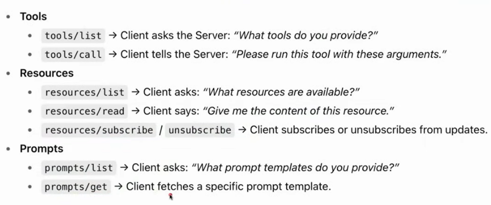

  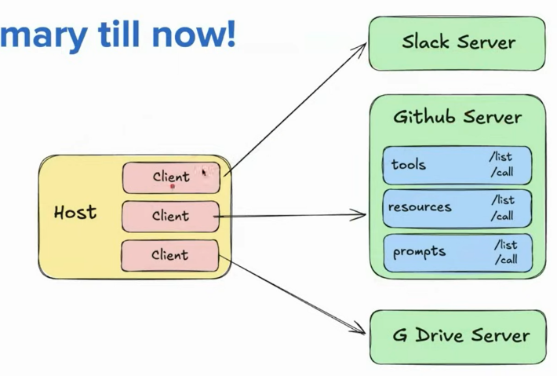

  - To connect with each MCP server, there should be a specific host.
  - Each server offers three primitives. Tools, resources and prompts
  - MCP consist of two layers:
    - Data Layer:
      - it defines the language and the grammar  of the MCP ecosystem that everyone agrees upon to communicate.
      - It uses Json RPC to communicate:
        - Request Structure

          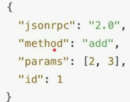

        - Response Structure:

          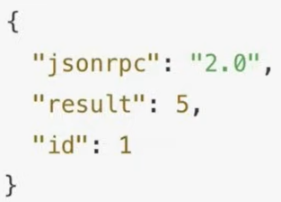

        - Why Json RPC for communication:
          - Ligh weight
          - Bi directional Communication
    - Transport Layer:
      - It helps to move Json RPC messages between client and Server
      - Transport Type
        - STDIO:
          - When both client and server exist on the same machine.
          - When communication happens using STDIO, client is responsible to start the server.
          - How it works:
            - The host launches the server as a subprocess on the same machine
            - The host write JSON RPC messages into the server STDIN
            - The server read those messages, process them and writes back responses to it's stdout
          - Benefits:
            - Fast: Data is passed directly between processes
            - Secure: no open ports
            - Simple
        - HTTP/SSE :
          - When client and server exist on different machines
          - Sends a POST request with a JSON payload
          - SSE: Server Sent Events and it's an extension of HTTP
          - The server can stream chunks of data as they are ready
          - Ideal for long running tasks.

    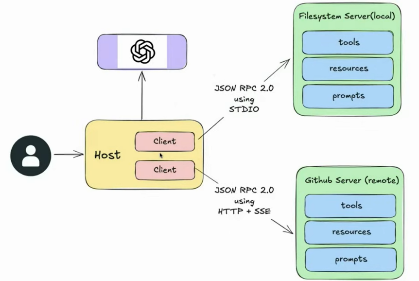

  - Stages of MCP Life cycle:

    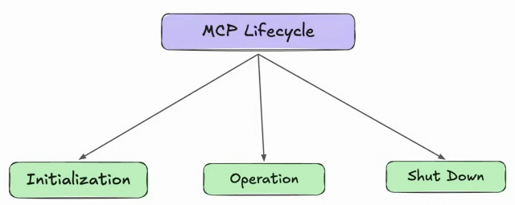

    - Initialization:
      - Steps of Initialization:
        - Client send initialization request to server

          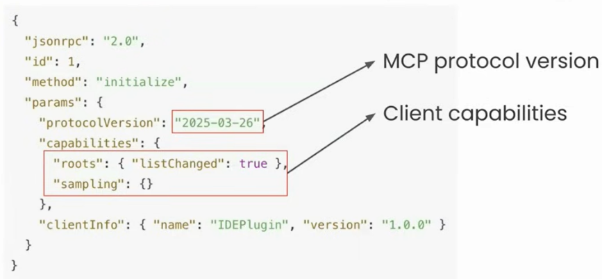

        - Server responds :

          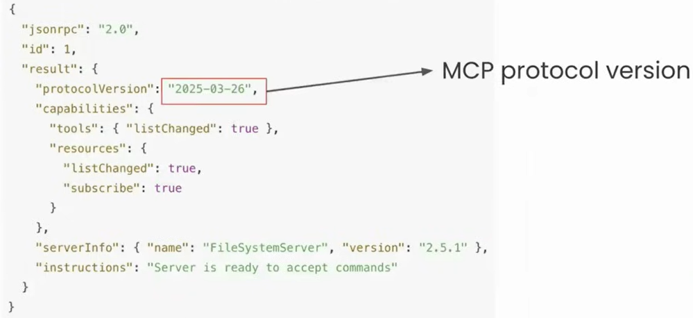

        - After successful, the client must send an initialized notification.

          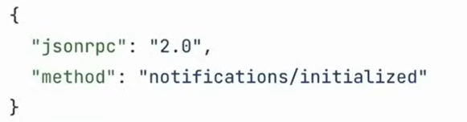

    - Operation Phase:
      - In this phase, the client and the server exchange messages according to the negotiated capabilities.
        - Tool Calling:

          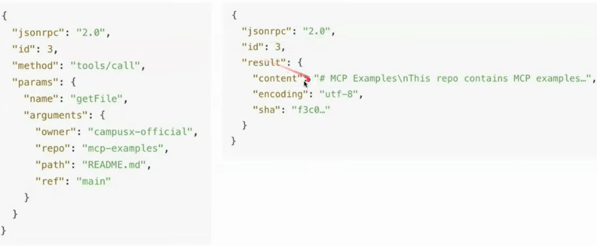

    - Shutdown phase:
      - Typically, client initiates shutdown
      - No special Json RPC message for shutdown
  - Fast MCP or MCP SDK
    - MCP SDK helps us to develop new MCP server and MCP client
    - It officially has three things in it:
      - Mcp.server = to build server
      - Mcp.client= to build client
      - Mcp.cli = for debugging and testing
    - Pip install mcp[cli] helps us to install all three in one go
    - It becomes the reference implementation
    - Problem with MCP SDK:
      - Raw SDK= verbose and boilerplate heavy(i.e. require a lot of code)
    - To solve this problem, there is an abstraction on top of MCP SDK called FastMCP.
    - It becomes so famous that it would be added by MCP SDK.
    - Later on, Fast MCP creators thought that there is a large scope of Fast MCP hence they again divided.
    - FastMCP 2.x released as standalone package.
    - To create MCP server there are two option:
      - Pip install mcp[cli] = which use mcp sdk
      - Pip install fastmcp

      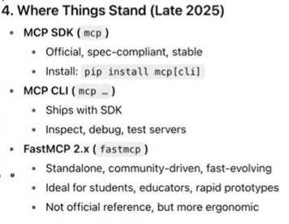

  - FastMCP and FastAPI
    - We can create Fast API app using FastMCP and vice versa
    - We have written a lot of code in FastAPI. Fast mcp provides us the facility to convert the convert fast api app into a fast mcp app.

    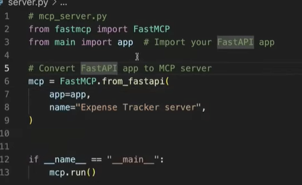

  - Local MCP Server:
  - To run mcp inspector:
    - Run : npx @modelcontextprotocol/inspector
  - To install MCP:
    - Uv add mcp
  - Practical Knowledge (to create a remote server):
    - MCP client via langchain:

      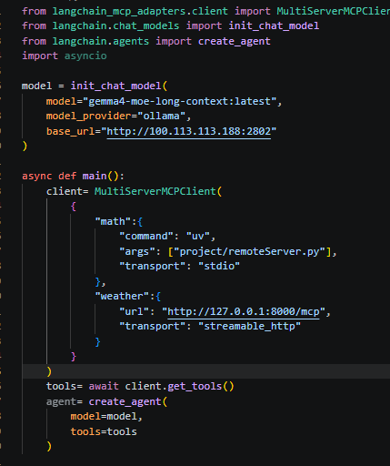

    - To create local server:

      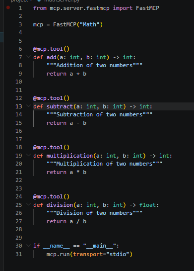

    - Create remote server:

      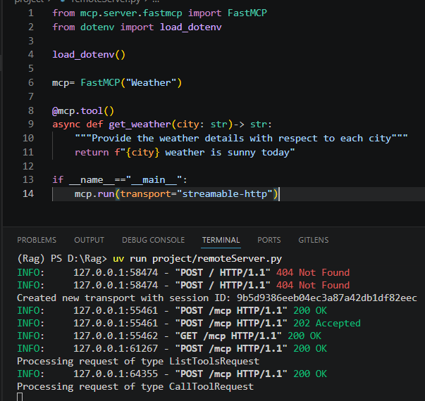

      - Then run : npx @modelcontextprotocol/inspector, which open mcp inspector
      - In the URL, write  that would connect you to MCP

    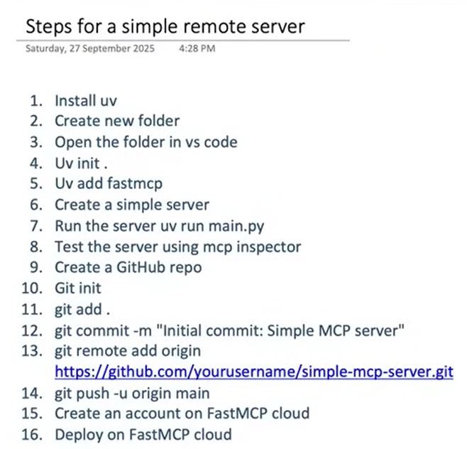

    - To run the mcp inspector use "uv run mcp inspector server.py"
