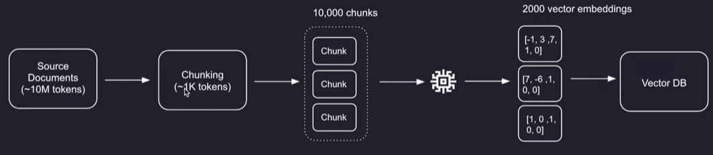
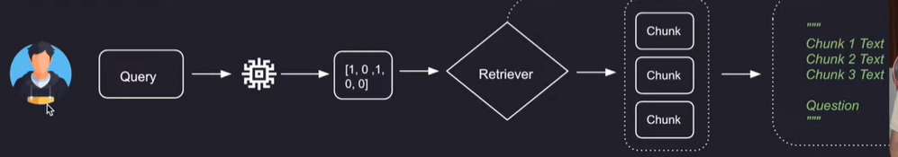
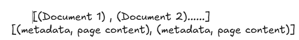
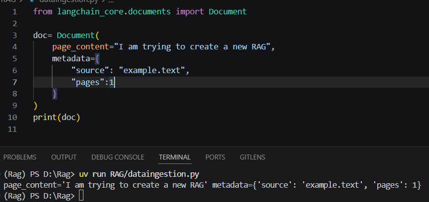
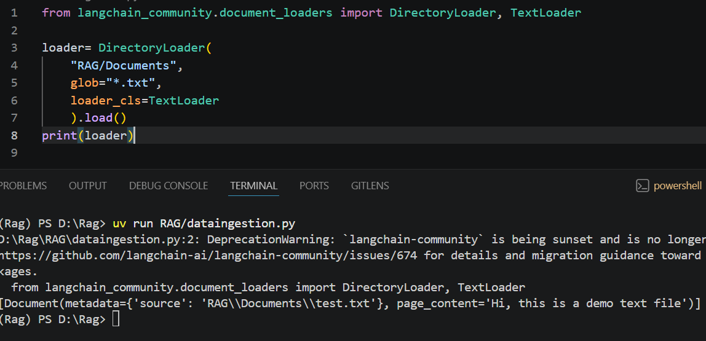
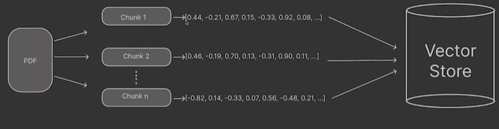
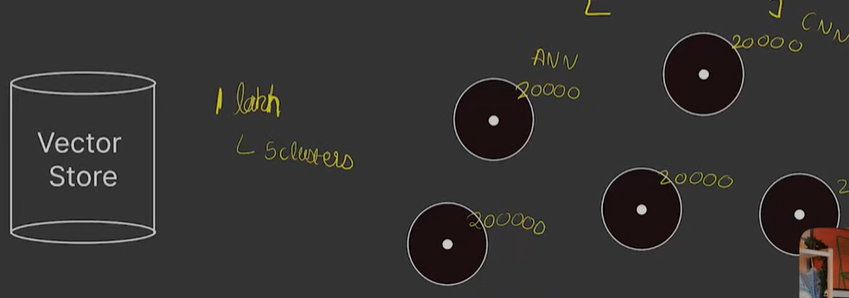
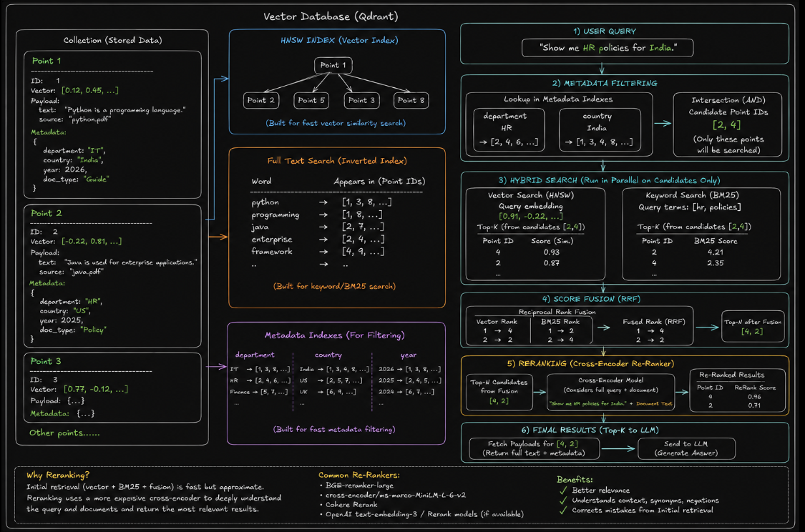
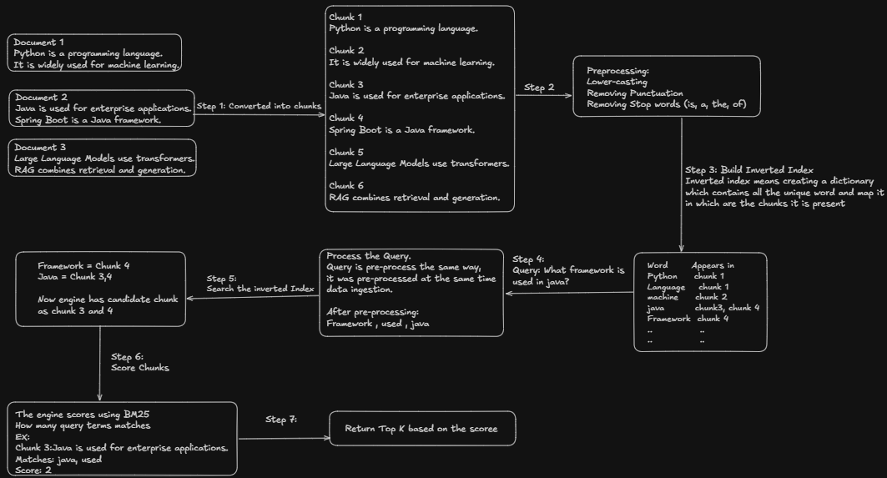
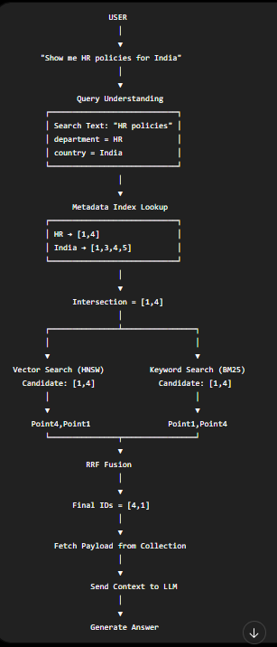

# RAG (Retrieval-Augmented Generation) - Notes & Concepts

> In-depth notes on Retrieval-Augmented Generation (RAG) — architecture, chunking, vector stores, reranking, evaluation metrics, and advanced RAG patterns.

---

  - RAG is a method though which we combines LLM with an external information like documentation , knowledge bases so that LLM can give better answers.
  - It consists pf two superpowers:
    - Retrieval : fetch relevant info from the external source
    - Augmented Generation: feed the info to the LLM to generate a proper response.
  - Example:
    - Let's assume you are working with 100 documents. If you ask a question which was related to one of the 100 document, LLM might not be able to answer or may get hallucinate.
    - To solve this problem, we have two options:
      - Train LLM on all the 100 document.
        - Takes more time, computation power
      - Having RAG: Fetch relevant part of the document which could help us to answer the query.
        - Takes less time no huge computation
  - Why we fetch only the relevant part from the external document ?
    - Context Length:
      - Each LLM has a context window that means how many tokens it can process at a time
      - If we give the complete document than it might be possible that the LLM misses some context
  - RAG is divided into two pipeline:
    - Knowledge base construction (Data Ingestion pipeline)
      - First step is to divide a bigger document into small chunks and this process is know as chunking
      - Then, this chunks are passes to an embedding model.
      - Embedding model converts chunks into the embedding.
        - Embedding: Mathematical representation of words, sentence or even images
      - These embedding are stored into a vector database

      

      - Why can't we directly give the documents to the embedding model instead of first chunking and then giving it to embedding model?
        - Every model has a context length that means how many tokens it can process at once and if we give the document directly to the embedding model, it won't be able to convert into embedding because of the document size
    - Retrieval Pipeline:
      - Query is converted into an embedding
      - Using retrieval, it takes the user query and makes a semantic search into a vector DB
        - Semantic search: which vectors are more relevant to each other.
      - Fetch all the relevant chunks from the vector DB and add with the user query and then send to the LLM

      

    - Important:
      - Use same embedding model in both the pipeline
    - How retrieval makes the semantic search into the vector DB?
      - Cosine similarity
        - It is the reason we are able to find the relevant chunks from the DB
        - It measure the angle between the vectors in a high dimensional space
        - It ranges from 0 to 1, with 0 being the least similar and 1 being the most similar.
    - Document object:
      - Langchain Document contains two main things as mentioned in the below image

        

        - Page content: All the data present in the file
        - Meta Data: It contains the other additional information like file name, how many pages etc.
          - It becomes very for the retriever because we can also filter based on the metadata.
          - Ex: let's suppose, user asked a query "give me ai related content where author is aniket yadav". In these scenario, I can filter using the metadata so that our retriever performance can increase

          

    - Document Loader:
      - It is used to load external documents.
      - There are so many document loader. Based on the use case, we decide which document loader to choose:
        - DirectoryLoader:

          

          - Here, glob is used to filter the files.
          - Loader_cls tell the directory loader about which loader to use for the files present in the directory.
        - PDF Loader
        - CSV loader
        - Web Based Loader
      - The O/P of these loaders are of document type
      - Inside the "langchain_community.document_loaders"
        - TextLoader: for loading text
        - Pypdf: for loading PDF
    - Text Splitter:
      - Context window
      - In RAG, it helps us to split a big text into small chunks which helps us to retrieve only the relevant part.
      - Return the list of documents based on the chunk size.
      - It would create the chunk within the same document. It won't happen that there will be a chunk which contains data from different document.
      - Faster processing
      - Three types of Text splitter:
        - Character - Based splitting
        - Token - Based Splitting
        - Recursive Text Splitter
          - It splits the a big text into chunks intelligently instead of breaking blindly
          - It uses multiple separators:
            - ["\n\n", "\n", " ", ""]
            - First, it tries to split based on paragraph(\n\n)
            - It chunk still too big based on the defined chunk size - split by lines
            - Still big split by  words " "
            - Last fall back - split by characters
        - Semantic Based Splitting (Most Used)
          - It is not being used as of now because It is under development
    - Vector Store:

      

      - It is not runnable that means we can't invoke
      - Why do we need a vector store?
        - let's suppose, we have  1000 token and each token has for example 512 dimensions.
        - we store it in a normal database
        - Traditional Databases are optimized for exact match  and range queries. Not optimized for semantic search
        - Also, then we must compute cosine similarity which gives time complexity O(N*D)
        - Hence, we use vector store
        - It used several algo like :
          - HNSW
          - IVF
          - ANN
        - Instead of checking all the vectors, it narrows down candidates
        - Example: IVF (INVERTED FILE INDEX)
          - It clusters same embedding.

          

          - Then we make a centroid for each cluster.
          - Now, for the query embedding, we find which cluster is suitable for searching and then we just search with that cluster
      - Types of vector store:
        - Chroma
        - FAISS
        - Annoy

        

  - Retriever:
    - A retriever takes the user query and return the most relevant documents or chunks from the database
    - 2 types of retriever:
      - By data source (Wikipedia etc)
      - By retrieval strategy (similarity, MMR etc)
    - In vector store there are two ways we can retrieve
      - Vectorstore.similarity_search("which is used for data analysis", k=2)
        - It is not a runnable hence we can't use it in chains
        - It uses only 1 algo for search
      - Vectorstrore.as_retriever().invoke("explain deep learning")
        - runnable
        - Similarity search (Most Common)
          - The system compares the query vector with document vector in database based on the below:
            - Cosine similarity (most common)
            - Dot product
            - Euclidean
    - Types of Retriever:
      - Dense Retriever
        - It is a retriever technique which uses the semantic meaning of the query, it searched in the vector DB which is the most relevant chunk using the cosine similarity.
        - It is called Dense very embedding vector contains the non-zero values.
      - Sparse Retriever:
        - It retrieve the data based on the keyword match.
        - It uses BM25 algo for search

        

      - Multi Query Retriever:
        - It converts the actual query into multiple queries
        - Search based on each query
        - Once the response got for all the queries
        - Merge all the results
      - Hybrid Retrieval
        - A combination of dense and sparse retrieval
        - Often used in enterprise system
  - RAG retrieval pipeline having hybrid search and meta data filtering:

    

  - Suppose your RAG Application is giving poor answer and User Complains "The information exists in the PDF but the chatbot is not finding it"
    - There are several ways to improve the RAG application:
    - Chunk size: We would use a good chunk size instead of chunking the complete document in 1 or 2 chunks. Usually, a chunk size of 500-800 tokens is considered as a good chunk size.
    - Chunk overlap: It means how many tokens present at he end of first chunk will present at the start of next chunk. Usually, 20-30% of chunk size is considered as a good overlap.
    - Better embedding model: As good as you have a good embedding model, you would be able to store good amount of information for a chunk. Also, whatever embedding model that has been used at the time of data ingestion, we should we the same embedding model at the time of retriever.
    - Re-ranking: reorder the chunks that was retrieved by the retriever using another LLM. It helps us to use only the relevant chunks.
    - Multi query retriever: Let's suppose we have a query, we try to generate some alternate query. Each query performs retrieval and then results are combined
    - Hybrid search: It performs similarity search +  keyword search. In document, we also store the metadata that meta data could be used to perform keyword search.
